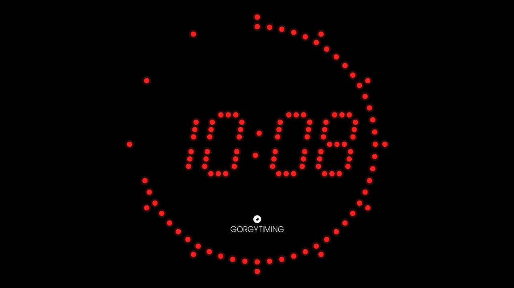
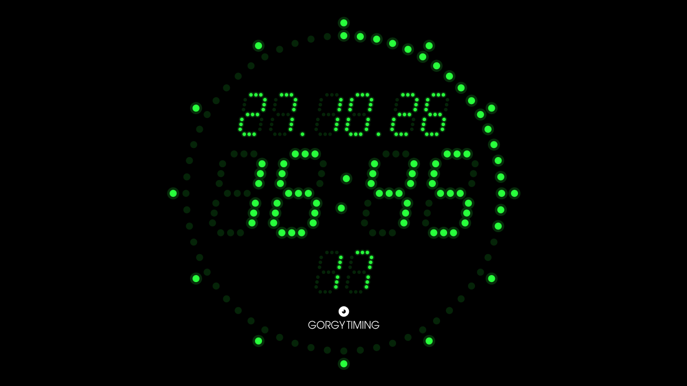
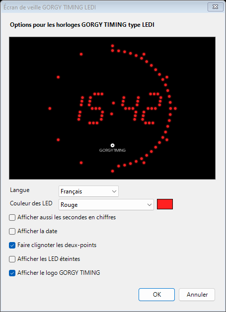

# Écran de veille GORGY TIMING LEDI

Écran de veille pour **Windows 10 et 11** qui reproduit l'affichage des horloges
GORGY TIMING de la gamme LEDI.



C'est une réécriture en C# de l'écran de veille LEDI d'origine. L'ancien était un
programme Windows 3.x 16 bits, et Windows 64 bits ne peut plus lancer ce type de programme.

## Fonctionnalités

- Couronne de 60 LED qui s'allument une à une au fil des secondes, plus une LED de
  repère toutes les 5 minutes.
- Heure HH:MM en chiffres inclinés formés de points LED, avec deux-points clignotants.
- Logo GORGY TIMING entièrement vectoriel, donc net même en 4K.
- Horloge centrée sur chaque écran, compatible avec la mise à l'échelle Windows
  (125 %, 150 %…).
- Aperçu dans la petite fenêtre des paramètres d'écran de veille de Windows.
- Fenêtre de réglages en français, anglais, allemand et espagnol, avec aperçu en direct.

| Avec toutes les options                                  | Réglages                                     |
|----------------------------------------------------------|----------------------------------------------|
|  |  |

Options proposées :
- couleur des LED (rouge, vert, ambre, bleu, blanc ou couleur personnalisée) ;
- date au-dessus de l'heure ;
- secondes en chiffres sous l'heure ;
- LED éteintes visibles ;
- clignotement des deux-points ;
- affichage du logo.

Les réglages sont enregistrés par utilisateur dans
`HKEY_CURRENT_USER\Software\GorgyTiming\LediScreenSaver`.

## Installation

### Avec l'installeur

Lancez `GorgyLedi-Setup-<version>.exe`. Il demande les droits administrateur, puis :
1. copie `GorgyLedi.scr` dans `C:\Windows\System32` ;
2. le définit comme écran de veille actif, si l'option est cochée ;
3. ouvre les paramètres d'écran de veille, si l'option est cochée.

Pour le désinstaller, passez par *Paramètres → Applications installées*.

### À la main

- Copiez `GorgyLedi.scr` dans `C:\Windows\System32`, ou lancez `install.bat` en tant
  qu'administrateur.
- Sans droits administrateur : clic droit sur `GorgyLedi.scr` → *Installer*.

Le programme fonctionne sur tout Windows 10 ou 11 sans rien installer d'autre :
il utilise le .NET Framework 4.8, déjà fourni avec Windows.

## Compilation

| Commande                                    | Résultat                                  |
|---------------------------------------------|-------------------------------------------|
| `build.bat`                                 | `GorgyLedi.scr`                           |
| `./build.sh` (Linux, Mono)                  | `GorgyLedi.scr` (identique, utilisé par la CI) |
| `build-installer.bat`                       | `.scr`, puis `dist\GorgyLedi-Setup-<version>.exe` |
| `makensis installer/GorgyLedi.nsi` (Linux)  | installeur, à partir d'un `.scr` déjà compilé (créer `dist/` avant) |

`build.bat` utilise le compilateur C# fourni avec Windows
(`%WINDIR%\Microsoft.NET\Framework64\v4.0.30319\csc.exe`). Il ne faut donc ni SDK .NET
ni Visual Studio, mais **le code doit rester en C# 5** : pas de `$"..."`, `?.`, `nameof`,
membres `=>`, etc.

L'installeur nécessite [NSIS 3](https://nsis.sourceforge.io) (`winget install NSIS.NSIS`,
ou le paquet `nsis` sous Linux). Le numéro de version se change à deux endroits :
`src/AssemblyInfo.cs`, et `VERSION` dans `installer/GorgyLedi.nsi` (ou
`makensis -DVERSION=x.y.z`).

`build.sh` compile avec `mcs` (paquet `mono-devel`) en `-langversion:5`. Une erreur
de syntaxe trop récente est donc aussi détectée par la CI. Le binaire produit tourne sur le
.NET Framework de Windows.

### Intégration continue (Gitea Actions)

`.gitea/workflows/build.yml` compile le `.scr` et l'installeur sur un runner Linux :
- **push sur `main` et pull requests** : les binaires sont disponibles en artefact du run ;
- **tag `vX.Y.Z`** : la version `X.Y.Z` est appliquée au `.scr` et à l'installeur, puis
  les deux fichiers sont publiés dans une release Gitea.

```sh
git tag v1.1.0 && git push origin v1.1.0
```

Si le jeton automatique n'a pas le droit de créer des releases sur votre instance, créez
un jeton d'accès (portée *repository* en écriture), enregistrez-le comme secret du dépôt
et remplacez `secrets.GITHUB_TOKEN` dans le workflow.

### Lancer sans installer

| Commande             | Effet                                         |
|----------------------|-----------------------------------------------|
| `GorgyLedi.scr /s`   | plein écran, sur tous les moniteurs           |
| `GorgyLedi.scr /p <hwnd>` | aperçu dans une fenêtre (utilisé par Windows) |
| `GorgyLedi.scr` ou `/c` | fenêtre de réglages                        |

## Organisation du dépôt

| Chemin                    | Rôle                                                        |
|---------------------------|-------------------------------------------------------------|
| `src/Program.cs`          | point d'entrée, arguments `/s` `/p` `/c`, DPI               |
| `src/LedRenderer.cs`      | dessin de l'horloge ; proportions réglables en tête de fichier |
| `src/Logo.cs`             | dessin du logo vectoriel                                    |
| `src/LogoGeometry.cs`     | tracés du texte du logo (**généré** par `tools/gen_logo.py`) |
| `src/SaverForm.cs`        | fenêtre plein écran ou aperçu, sortie souris/clavier        |
| `src/ConfigForm.cs`       | fenêtre de réglages avec aperçu en direct                   |
| `src/Settings.cs`         | réglages dans le registre                                   |
| `src/Strings.cs`          | traductions                                                 |
| `res/icon.ico`            | icône (**générée** par `tools/gen_icon.py`)                 |
| `installer/GorgyLedi.nsi` | script de l'installeur NSIS                                 |
| `.gitea/workflows/`       | intégration continue Gitea Actions                          |
| `tools/`                  | scripts Python de génération du logo et de l'icône          |

Pour régénérer le logo ou l'icône (Python 3, `fonttools`, `Pillow`) :

```sh
curl -LO https://mirrors.ctan.org/fonts/tex-gyre/opentype/texgyreadventor-regular.otf
python3 tools/gen_logo.py texgyreadventor-regular.otf > src/LogoGeometry.cs
python3 tools/gen_icon.py res/icon.ico
```

## Licence

Code sous licence [MIT](LICENSE).

## Crédits

- Le texte du logo est tracé à partir des contours de
  [TeX Gyre Adventor](https://www.gust.org.pl/projects/e-foundry/tex-gyre/adventor)
  (GUST Font License), ajustés pour correspondre au logo d'origine.
- GORGY TIMING, LEDI et le logo GORGY TIMING sont des marques de GORGY TIMING.
